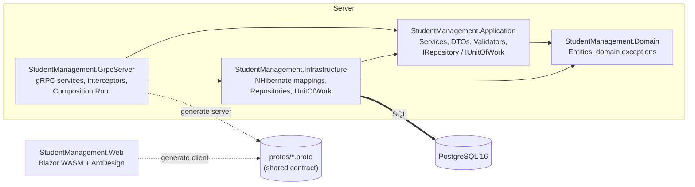
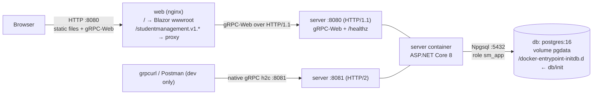
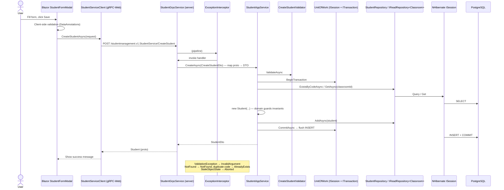
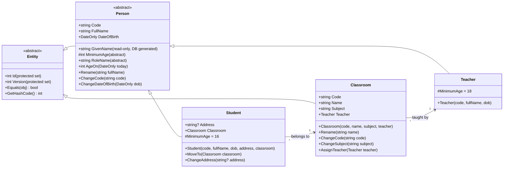
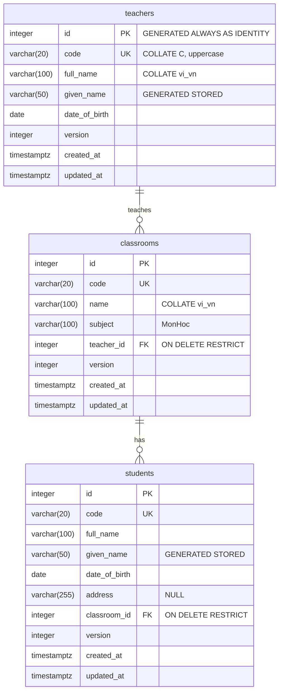

# Kế hoạch dự án: Hệ thống quản lý sinh viên (Student Management System)

> Gộp 6 bài thực hành trong [Task.md](Task.md) thành **một** sản phẩm: Blazor WASM + Ant Design → gRPC-Web → ASP.NET Core gRPC Server → Service → Repository/UoW → NHibernate → PostgreSQL 16, chạy bằng Docker Compose.
>
> Tài liệu này chỉ là **kế hoạch**: chưa có code. Mọi tên class/project là tên đề xuất.

---

## 0. Quyết định thiết kế (đã chốt)

| # | Vấn đề | Quyết định | Lý do |
|---|--------|------------|-------|
| D1 | CSDL | **PostgreSQL 16** (image `postgres:16`, bản Debian) | Image nhẹ (~150MB so với ~1.5GB của SQL Server), khởi động vài giây, chạy native trên ARM; collation ICU `vi-VN` cho sắp xếp tiếng Việt; Testcontainers nhanh; NHibernate hỗ trợ ổn (`PostgreSQL83Dialect` + `NpgsqlDriver`). Dùng bản Debian thay vì Alpine để chắc chắn có ICU. |
| D2 | Mapping NHibernate | **Mapping-by-code** (`ClassMapping<T>`, có sẵn trong NHibernate) | Không thêm dependency, do chính team NHibernate bảo trì. Fluent NHibernate chỉ là lớp bọc và cập nhật chậm. |
| D3 | Blazor hosting | **Blazor WebAssembly standalone** + **gRPC-Web**; nginx phục vụ file tĩnh và **reverse-proxy** các path gRPC-Web về server | Đúng nghĩa SPA, client/server là 2 container riêng. Cùng origin nên không cần CORS trong Docker, và client không phải biết URL server. |
| D4 | Kiến trúc | **Clean Architecture**: Domain / Application / Infrastructure / GrpcServer + Web | Mỗi bài tập ứng với một lớp rõ ràng; Dependency Rule thể hiện DIP. |
| D5 | Ngôn ngữ | **Mọi thứ trong code bằng tiếng Anh**: tên project/namespace/class/method/biến, **comment**, file `.proto` (kể cả comment), tên bảng/cột, log message, commit message. **Chỉ chuỗi hiển thị cho người dùng** (label UI, thông báo lỗi trên form) là tiếng Việt, gom một chỗ (mục 0.2). | Đã chốt. |
| D6 | Khóa chính | **Surrogate key** `id` (`integer GENERATED ALWAYS AS IDENTITY`) + `code` (Mã số) `UNIQUE` | Sửa Mã số không phải cascade khóa ngoại; NHibernate làm việc với id số đơn giản hơn. |
| D7 | "Sắp xếp theo tên" | Sắp theo **tên riêng (từ cuối của họ tên)**, rồi đến **họ tên đầy đủ**, rồi `id` (tie-breaker cho phân trang ổn định), dùng collation ICU **`vi_vn`**. `given_name` là **generated column `STORED`** có index. Áp dụng cho cả `students` và `teachers` (cùng kế thừa `Person`). | Đã chốt. Người Việt hiểu "theo tên" là theo tên riêng: An < Bình, Dũng < Đức. |
| D8 | "Tìm theo Mã số" | `GetStudentByCode` tìm **chính xác**; các RPC `List*` lọc **theo tiền tố** (`code LIKE 'SV00%'`). Cột `code` dùng `COLLATE "C"` để B-tree index phục vụ được `LIKE` tiền tố. Mã luôn được chuẩn hóa thành chữ HOA trong domain. | Ô tìm kiếm trên UI cần tìm gần đúng. |
| D9 | Phạm vi CRUD | **CRUD đầy đủ cho cả 3**: Sinh viên, Lớp học, Giáo viên | Đã chốt. Quy tắc xóa: không xóa được lớp còn sinh viên, không xóa được giáo viên còn phụ trách lớp. |
| D10 | Client | **Không làm Console app.** Client duy nhất là Blazor Web, gọi mọi thứ **qua gRPC**. "Menu chức năng" của Bài 1 = Sider menu của web. Bài 1–4 được kiểm bằng **test tự động**; từ Bài 5 kiểm thêm bằng `grpcurl` và integration test gRPC. | Đã chốt. |
| D11 | Quản lý schema | **SQL script tay** (`db/init/*`), mount vào `/docker-entrypoint-initdb.d`; Postgres tự chạy **lần đầu** khởi tạo volume. **NHibernate `SchemaValidator`** chạy khi app khởi động. | Không cần thêm container init. Đề bài yêu cầu có script tạo bảng; validator bắt lỗi lệch mapping ↔ DB ngay lúc start. Khi cần migration theo version thì nâng cấp lên DbUp/FluentMigrator. |
| D12 | Entity ↔ DTO ↔ proto | **Map thủ công** bằng extension methods | Tường minh, không dính bẫy lazy-load ngầm. AutoMapper từ v15 đã chuyển sang license thương mại. |
| D13 | Sửa đồng thời | **Optimistic concurrency**: cột `version integer` (NHibernate `Version`) | Hai người sửa cùng bản ghi thì người lưu sau nhận lỗi, không âm thầm ghi đè. |
| D14 | Thư viện test | xUnit + NSubstitute + Shouldly + **Testcontainers.PostgreSql** | FluentAssertions v8 đã đổi sang license thương mại. Test trên **đúng** PostgreSQL (collation, generated column), không dùng SQLite giả lập. |
| D15 | Logging | `ILogger` built-in; ra **JSON console** khi chạy container | Không thêm dependency. Muốn tìm log tập trung thì nâng cấp lên Serilog + Seq sau. |
| D16 | Tài khoản DB | App dùng role riêng **`sm_app`** (chỉ có `SELECT/INSERT/UPDATE/DELETE` trên bảng + `USAGE` trên sequence), **không dùng superuser `postgres`**. Script init (chạy bằng `postgres`) tạo schema và role. | Least privilege; app không có quyền DDL. |

### 0.1 Bảng thuật ngữ

| Đề bài | Code (C#) | Bảng DB |
|--------|-----------|---------|
| SinhVien (MaSo, Ten, NgaySinh, DiaChi, LopHoc) | `Student` (`Code`, `FullName`, `DateOfBirth`, `Address`, `Classroom`) | `students` (`code`, `full_name`, `date_of_birth`, `address`, `classroom_id`) |
| LopHoc (MaSo, TenLop, MonHoc, GiaoVien) | `Classroom` (`Code`, `Name`, `Subject`, `Teacher`) | `classrooms` (`code`, `name`, `subject`, `teacher_id`) |
| GiaoVien (MaSo, Ten, NgaySinh) | `Teacher` (`Code`, `FullName`, `DateOfBirth`) | `teachers` (`code`, `full_name`, `date_of_birth`) |

`MonHoc` không gạch chân nên là kiểu nguyên thủy (`string`), không tách bảng riêng.

### 0.2 Quy ước code

- C# dùng **PascalCase**; DB dùng **snake_case**. PostgreSQL tự hạ chữ thường các identifier không có dấu nháy, nên dùng PascalCase ở DB sẽ phải bọc `"..."` khắp nơi. Việc chuyển `FullName → full_name` làm **một lần** bằng naming convention của `ModelMapper` (các event `BeforeMapProperty`/`BeforeMapClass`/`BeforeMapManyToOne`), không khai báo tên cột thủ công cho từng property.
- Comment tiếng Anh, chỉ giải thích **vì sao**, không diễn giải lại code đang làm gì. Dùng XML doc (`///`) cho interface public của Application.
- Chuỗi tiếng Việt hiển thị cho người dùng gom về **một nơi mỗi tầng**: thông báo validation ở `Application/Common/Messages.cs`, label UI ở `Web/Resources/UiText.cs`. Server trả thêm **error code tiếng Anh** (ví dụ `STUDENT_CODE_DUPLICATED`) trong trailer để UI/log tra cứu được.
- Commit message tiếng Anh, theo Conventional Commits (`feat:`, `fix:`, `test:`, `chore:`...).

---

## 1. Tóm tắt kiến trúc

### 1.1 Các lớp & Dependency Rule

Mũi tên là **compile-time reference**. Domain không phụ thuộc gì; Infrastructure implement các interface do Application định nghĩa (DIP). GrpcServer là **Composition Root**. Web chỉ biết file `.proto`.



### 1.2 Triển khai (Docker Compose)



Thứ tự khởi động: `db` (healthy: `pg_isready`) → `server` (healthy: `/healthz`) → `web`.

### 1.3 Luồng một request: "Thêm sinh viên"



### 1.4 Vòng đời đối tượng (DI)

| Đối tượng | Lifetime | Lý do |
|-----------|----------|-------|
| `ISessionFactory` | Singleton | Tạo tốn kém, thread-safe |
| `ISession` | Scoped (mỗi gRPC call 1 session) | Không thread-safe; là first-level cache + unit of work của NH |
| `IUnitOfWork`, `IRepository<T>`, `I*Repository` | Scoped | Dùng chung `ISession` của scope |
| `I*AppService` | Scoped | — |
| Validators | Singleton | Không giữ state |
| gRPC services | Scoped (mặc định) | — |
| Web: `GrpcChannel` + clients | Singleton (trong WASM) | Channel tốn kém, tái sử dụng được |

---

## 2. Cấu trúc solution

```
TrainingSDS_StudentManagement/
├── StudentManagement.sln
├── global.json                    # pin SDK 8.0.x
├── Directory.Build.props          # net8.0, Nullable, TreatWarningsAsErrors
├── Directory.Packages.props       # Central Package Management
├── .editorconfig  .gitattributes  .gitignore  .dockerignore
├── .env.example                   # POSTGRES_PASSWORD, APP_DB_PASSWORD (.env bị gitignore)
├── docker-compose.yml
├── docker-compose.override.yml    # dev: publish 5433→5432 và 8081, log level Debug
├── protos/
│   ├── common.proto               # Date, SortDirection, PageInfo, CountByLabel
│   ├── student.proto
│   ├── classroom.proto
│   ├── teacher.proto
│   └── report.proto
├── db/
│   ├── init/00_app_role.sh        # create role sm_app with $APP_DB_PASSWORD (psql, chạy bởi initdb)
│   ├── init/01_schema.sql         # collation vi_vn, tables, PK/FK/UNIQUE/CHECK, generated columns, indexes, grants
│   ├── init/02_seed.sql           # 5 teachers, 8 classrooms, ~60 students
│   └── erd.md
├── docs/
│   ├── OOP_SOLID_MAP.md           # chỉ rõ file/dòng thể hiện từng nguyên tắc (viết dần)
│   └── screenshots/
├── src/
│   ├── StudentManagement.Domain/
│   │   ├── Common/Entity.cs, Person.cs
│   │   ├── Students/Student.cs
│   │   ├── Classrooms/Classroom.cs
│   │   ├── Teachers/Teacher.cs
│   │   └── Exceptions/DomainException.cs
│   ├── StudentManagement.Application/
│   │   ├── Abstractions/IReadRepository.cs, IRepository.cs, IUnitOfWork.cs
│   │   ├── Students/IStudentRepository.cs, IStudentAppService.cs, StudentAppService.cs,
│   │   │            StudentQuery.cs, Dtos/, Validators/
│   │   ├── Classrooms/ (cùng cấu trúc)
│   │   ├── Teachers/   (cùng cấu trúc)
│   │   ├── Reports/IReportQueries.cs, IReportAppService.cs, ReportAppService.cs, DashboardDto.cs
│   │   ├── Common/PagedResult.cs, SortDirection.cs, Messages.cs, Exceptions/
│   │   └── DependencyInjection.cs   # AddApplication()
│   ├── StudentManagement.Infrastructure/
│   │   ├── Persistence/NHibernateOptions.cs, SessionFactoryBuilder.cs, SnakeCaseNamingConvention.cs
│   │   ├── Persistence/Mappings/PersonMapping<T>.cs, StudentMapping.cs, ClassroomMapping.cs, TeacherMapping.cs
│   │   ├── Persistence/Repository<T>.cs, UnitOfWork.cs,
│   │   │              StudentRepository.cs, ClassroomRepository.cs, TeacherRepository.cs, ReportQueries.cs
│   │   ├── Persistence/DbExceptionTranslator.cs    # SqlState 23505 → Conflict, 23503 → Conflict(FK)
│   │   ├── HealthChecks/DatabaseHealthCheck.cs
│   │   └── DependencyInjection.cs   # AddInfrastructure(config)
│   ├── StudentManagement.GrpcServer/
│   │   ├── Services/StudentGrpcService.cs, ClassroomGrpcService.cs, TeacherGrpcService.cs, ReportGrpcService.cs
│   │   ├── Mapping/ProtoMappings.cs
│   │   ├── Interceptors/ExceptionInterceptor.cs, LoggingInterceptor.cs
│   │   ├── Program.cs               # Composition Root, 2 Kestrel endpoints, gRPC-Web, CORS (dev), health
│   │   ├── appsettings*.json
│   │   └── Dockerfile
│   └── StudentManagement.Web/       # Blazor WASM standalone
│       ├── Layout/MainLayout.razor  # AntDesign Layout + Sider menu
│       ├── Pages/Students.razor, Classrooms.razor, Teachers.razor, Reports.razor, NotFound.razor
│       ├── Components/StudentFormModal.razor, ClassroomFormModal.razor, TeacherFormModal.razor
│       ├── Services/GrpcErrorHandler.cs
│       ├── Models/*FormModel.cs     # DataAnnotations
│       ├── Resources/UiText.cs      # Vietnamese UI strings
│       ├── wwwroot/appsettings*.json  # GrpcBaseUrl (rỗng = cùng origin)
│       ├── nginx.conf
│       └── Dockerfile
├── tests/
│   ├── StudentManagement.Domain.Tests/
│   ├── StudentManagement.Application.Tests/      # + InMemoryRepository<T> fake + repository contract tests
│   ├── StudentManagement.Infrastructure.Tests/   # Testcontainers PostgreSQL
│   └── StudentManagement.GrpcServer.Tests/       # WebApplicationFactory + gRPC client (bắt buộc, vì không có console)
└── .github/workflows/ci.yml       # build → test → docker build
```

### 2.1 Trách nhiệm & package từng project

| Project | Trách nhiệm | Tham chiếu | NuGet chính |
|---------|-------------|------------|-------------|
| **Domain** | Entity, invariant nghiệp vụ, domain exception. Không biết DB, không biết gRPC. | — | *(không có)* |
| **Application** | Use case (service) cho 3 thực thể + báo cáo, DTO, validation, interface repository/UoW, query object (paging/sort/filter). | Domain | `FluentValidation`, `FluentValidation.DependencyInjectionExtensions`, `Microsoft.Extensions.Logging.Abstractions`, `Microsoft.Extensions.DependencyInjection.Abstractions` |
| **Infrastructure** | NHibernate: cấu hình, mapping-by-code + naming convention, `Repository<T>`, `UnitOfWork`, repository chuyên biệt, query báo cáo, dịch lỗi DB, health check. | Application, Domain | `NHibernate` (5.5.x), `Npgsql`, `Microsoft.Extensions.Diagnostics.HealthChecks` |
| **GrpcServer** | Host ASP.NET Core: gRPC service (lớp transport mỏng), map proto ↔ DTO, interceptor bắt lỗi/log, gRPC-Web, CORS (dev), health, reflection (dev). | Application, Infrastructure | `Grpc.AspNetCore`, `Grpc.AspNetCore.Web`, `Grpc.AspNetCore.Server.Reflection`, `Grpc.StatusProto` |
| **Web** | Blazor WASM SPA, Ant Design UI, biểu đồ, gọi gRPC-Web. | *(chỉ proto)* | `Microsoft.AspNetCore.Components.WebAssembly`, `AntDesign` (1.x), `AntDesign.Charts`, `Grpc.Net.Client`, `Grpc.Net.Client.Web`, `Google.Protobuf`, `Grpc.Tools` |
| **Domain.Tests** | Test invariant + polymorphism tuổi tối thiểu. | Domain | `xunit`, `Shouldly` |
| **Application.Tests** | Unit test service + validator; `InMemoryRepository<T>` (fake) + contract test chung cho `IRepository<T>`. | Application | `xunit`, `NSubstitute`, `Shouldly`, `coverlet.collector` |
| **Infrastructure.Tests** | Integration test mapping, repository, query báo cáo, collation, `SchemaValidator`, concurrency, contract test chạy lại trên NH. | Infrastructure | `Testcontainers.PostgreSql`, `xunit`, `Shouldly` |
| **GrpcServer.Tests** | Test đầu-cuối gRPC: CRUD happy path cho 3 service, mỗi status code ở mục 4.6, mapping proto. | GrpcServer | `Microsoft.AspNetCore.Mvc.Testing`, `Grpc.Net.Client`, `Testcontainers.PostgreSql` |

> Chia sẻ proto: mỗi project include file proto qua `<Protobuf Include="..\..\protos\student.proto" GrpcServices="Server|Client" Link="Protos\student.proto" />`. Không cần project Contracts riêng.

---

## 3. Thiết kế domain & CSDL

### 3.1 Class diagram



Quy tắc thiết kế entity:
- **Mọi member public đều `virtual`**: NHibernate cần để tạo lazy proxy. Setter `protected`, constructor không tham số `protected` (dành cho NHibernate).
- **Thay đổi state qua method** (`Rename`, `MoveTo`, `AssignTeacher`...). Các method validate và ném `DomainException`. Đây là phần **Encapsulation**.
- **Quan hệ một chiều** (Student → Classroom → Teacher), không có collection ngược. Tránh lazy collection/N+1; "lớp còn sinh viên?", "giáo viên còn lớp?" và sĩ số lấy bằng query trong repository.
- `GivenName` chỉ đọc từ DB (generated column), domain không tự tính để tránh hai nguồn sự thật.
- `Code` chuẩn hóa `Trim().ToUpperInvariant()`; `FullName` được trim và gộp khoảng trắng thừa.

### 3.2 ERD



### 3.3 Mô tả bảng & ràng buộc (hiện thực trong `db/init/01_schema.sql`)

Đầu script: `CREATE COLLATION vi_vn (provider = icu, locale = 'vi-VN');`. Database tạo với encoding `UTF8` (mặc định của image), nên `varchar` lưu Unicode tiếng Việt bình thường, không cần kiểu `nvarchar` như SQL Server.

**`teachers`**

| Cột | Kiểu | Ràng buộc |
|-----|------|-----------|
| id | `integer GENERATED ALWAYS AS IDENTITY` | `pk_teachers` |
| code | `varchar(20) COLLATE "C"` | `NOT NULL`, `uq_teachers_code`, `ck_teachers_code`: `code ~ '^[A-Z0-9]{3,20}$'` (chặn cả chữ thường) |
| full_name | `varchar(100) COLLATE vi_vn` | `NOT NULL`, `ck_teachers_full_name`: `length(btrim(full_name)) > 0` |
| given_name | `varchar(50) COLLATE vi_vn GENERATED ALWAYS AS (regexp_replace(btrim(full_name), '^.*\s', '')) STORED` | Lấy từ cuối cùng của họ tên |
| date_of_birth | `date` | `NOT NULL`, `ck_teachers_date_of_birth`: `date_of_birth >= '1900-01-01'` |
| version | `integer` | `NOT NULL DEFAULT 1` |
| created_at / updated_at | `timestamptz` | `NOT NULL DEFAULT now()` |

Index: `ix_teachers_given_name_full_name (given_name, full_name, id)`.

**`classrooms`**: `code` (như trên), `name varchar(100) COLLATE vi_vn NOT NULL`, `subject varchar(100) COLLATE vi_vn NOT NULL`, `teacher_id integer NOT NULL` + `fk_classrooms_teachers` (`REFERENCES teachers(id) ON DELETE RESTRICT`), `version`, `created_at`, `updated_at`.
Index: `uq_classrooms_code`, `ix_classrooms_teacher_id`. PostgreSQL **không** tự tạo index cho FK.

**`students`**: `code`, `full_name`, `given_name` (generated như teachers), `date_of_birth`, `address varchar(255) NULL`, `classroom_id integer NOT NULL` + `fk_students_classrooms` (`ON DELETE RESTRICT`), `version`, `created_at`, `updated_at`.

| Index | Phục vụ |
|-------|---------|
| `uq_students_code` (UNIQUE, collation C) | Tìm chính xác + theo tiền tố (`code LIKE 'SV00%'` → index scan) |
| `ix_students_given_name_full_name (given_name, full_name, id)` | Sắp xếp theo tên + phân trang `LIMIT/OFFSET` ổn định |
| `ix_students_classroom_id` | Lọc theo lớp, đếm sĩ số, kiểm tra trước khi xóa lớp |

Các quyết định ràng buộc:
- `ON DELETE RESTRICT`: không xóa được lớp còn sinh viên, không xóa được giáo viên còn lớp. Service kiểm tra trước để trả lỗi dễ hiểu; FK là hàng rào cuối (SqlState `23503` → `FailedPrecondition`).
- "Ngày sinh không ở tương lai" và tuổi tối thiểu (16/18) kiểm ở **domain/validator**. Lý do: PostgreSQL coi `CHECK` là immutable nên không nên dùng `current_date` trong đó, và tuổi tối thiểu còn khác nhau theo loại `Person` (polymorphism). DB chỉ chặn ngày vô lý (`< 1900`).
- `updated_at` do app set (trong `Repository<T>.UpdateAsync`), không dùng trigger.
- Cuối `01_schema.sql`: `GRANT CONNECT` trên database, `USAGE` trên schema `public`, `SELECT, INSERT, UPDATE, DELETE ON ALL TABLES`, `USAGE ON ALL SEQUENCES` cho `sm_app`.
- `00_app_role.sh` dùng `psql` với biến môi trường `APP_DB_PASSWORD` (từ `.env`) để tạo role, không hard-code mật khẩu. File `.sql` thuần không đọc được biến môi trường, vì vậy phần này phải viết bằng `.sh`.
- Script initdb **chỉ chạy khi volume rỗng**. Sửa schema trong giai đoạn dev thì chạy `docker compose down -v` rồi `up` lại.

---

## 4. gRPC contract (`protos/`)

Package `studentmanagement.v1`, `option csharp_namespace = "StudentManagement.Contracts.V1";`. Comment trong proto bằng tiếng Anh. **Chỉ dùng unary RPC** (gRPC-Web không hỗ trợ client/bidi streaming, và dự án không cần streaming).

### 4.1 Message dùng chung (`common.proto`)

| Message / Enum | Field | Ghi chú |
|----------------|-------|---------|
| `Date` | `int32 year, month, day` | Protobuf không có kiểu ngày thuần; dùng `Timestamp` cho ngày sinh dễ lệch ±1 ngày do timezone |
| `SortDirection` | `SORT_DIRECTION_UNSPECIFIED = 0, ASC, DESC` | Giá trị 0 luôn là UNSPECIFIED |
| `PageInfo` | `int32 page, page_size, total_count` | |
| `CountByLabel` | `string label, int32 count` | Dữ liệu biểu đồ |
| `TeacherSummary` | `int32 id; string code; string full_name` | Nhúng trong Classroom |
| `ClassroomSummary` | `int32 id; string code; string name; string subject; TeacherSummary teacher` | Nhúng trong Student |

Response lồng `Student → ClassroomSummary → TeacherSummary` để thể hiện **tham chiếu đối tượng** đúng như đề bài.

### 4.2 `StudentService`

| RPC | Request | Response | Ghi chú |
|-----|---------|----------|---------|
| `ListStudents` | `{ int32 page; int32 page_size; StudentSortField sort_by; SortDirection direction; optional string code_prefix; optional int32 classroom_id; }` | `{ repeated Student items; PageInfo page_info; }` | Gộp **xem danh sách + sắp xếp + lọc**. `StudentSortField`: `UNSPECIFIED (= NAME), NAME, CODE, DATE_OF_BIRTH`. `page_size` tối đa 100. |
| `GetStudent` | `{ int32 id; }` | `Student` | Mở form sửa |
| `GetStudentByCode` | `{ string code; }` | `Student` | **Tìm chính xác theo MSSV** |
| `CreateStudent` | `{ string code; string full_name; Date date_of_birth; optional string address; int32 classroom_id; }` | `Student` | |
| `UpdateStudent` | `{ int32 id; int32 version; string code; string full_name; Date date_of_birth; optional string address; int32 classroom_id; }` | `Student` | `version` cho optimistic concurrency |
| `DeleteStudent` | `{ int32 id; }` | `google.protobuf.Empty` | |

`Student { int32 id; string code; string full_name; Date date_of_birth; optional string address; ClassroomSummary classroom; int32 version; }`

### 4.3 `ClassroomService`

| RPC | Request | Response | Ghi chú |
|-----|---------|----------|---------|
| `ListClassrooms` | `{ int32 page; int32 page_size; ClassroomSortField sort_by; SortDirection direction; optional string keyword; optional int32 teacher_id; }` | `{ repeated Classroom items; PageInfo page_info; }` | `ClassroomSortField`: `UNSPECIFIED (= CODE), CODE, NAME, SUBJECT`. `keyword` khớp tiền tố mã hoặc một phần tên lớp (`ILIKE`). Dropdown "chọn lớp" trong form SV dùng chính RPC này với `keyword` khi người dùng gõ. |
| `GetClassroom` | `{ int32 id; }` | `Classroom` | |
| `CreateClassroom` | `{ string code; string name; string subject; int32 teacher_id; }` | `Classroom` | `NotFound` nếu teacher không tồn tại |
| `UpdateClassroom` | `{ int32 id; int32 version; string code; string name; string subject; int32 teacher_id; }` | `Classroom` | |
| `DeleteClassroom` | `{ int32 id; }` | `Empty` | `FailedPrecondition` nếu lớp còn sinh viên |

`Classroom { int32 id; string code; string name; string subject; TeacherSummary teacher; int32 student_count; int32 version; }`

### 4.4 `TeacherService`

| RPC | Request | Response | Ghi chú |
|-----|---------|----------|---------|
| `ListTeachers` | `{ int32 page; int32 page_size; TeacherSortField sort_by; SortDirection direction; optional string keyword; }` | `{ repeated Teacher items; PageInfo page_info; }` | `TeacherSortField`: `UNSPECIFIED (= NAME), NAME, CODE, DATE_OF_BIRTH`. NAME dùng cùng quy tắc tên riêng như sinh viên. |
| `GetTeacher` | `{ int32 id; }` | `Teacher` | |
| `CreateTeacher` | `{ string code; string full_name; Date date_of_birth; }` | `Teacher` | Tuổi ≥ 18 |
| `UpdateTeacher` | `{ int32 id; int32 version; string code; string full_name; Date date_of_birth; }` | `Teacher` | |
| `DeleteTeacher` | `{ int32 id; }` | `Empty` | `FailedPrecondition` nếu còn phụ trách lớp |

`Teacher { int32 id; string code; string full_name; Date date_of_birth; int32 classroom_count; int32 version; }`

### 4.5 `ReportService`

| RPC | Request | Response |
|-----|---------|----------|
| `GetDashboard` | `{}` | `DashboardResponse { int32 total_students; int32 total_classrooms; int32 total_teachers; repeated CountByLabel students_by_classroom; repeated CountByLabel students_by_subject; repeated CountByLabel students_by_age_group; repeated CountByLabel classrooms_by_teacher; }` |

Một RPC cho cả dashboard (một round-trip). Mọi số liệu tính bằng **GROUP BY trong DB** (NH LINQ/HQL projection), không load toàn bộ lên RAM.

### 4.6 Quy ước lỗi (ExceptionInterceptor)

| Exception | gRPC `StatusCode` | Error code (trailer) | UI hiển thị |
|-----------|-------------------|----------------------|-------------|
| `ValidationException` (FluentValidation) / `DomainException` | `InvalidArgument` + `google.rpc.BadRequest` (field violations) | `VALIDATION_FAILED` | Lỗi gắn đúng field trên form |
| `NotFoundException` | `NotFound` | `*_NOT_FOUND` | "Không tìm thấy ..." |
| `ConflictException` (trùng mã, SqlState `23505`) | `AlreadyExists` | `*_CODE_DUPLICATED` | "Mã số đã tồn tại" |
| `ConflictException` (còn phụ thuộc, SqlState `23503`) | `FailedPrecondition` | `CLASSROOM_HAS_STUDENTS`, `TEACHER_HAS_CLASSROOMS` | "Lớp còn sinh viên, không thể xóa" |
| `StaleObjectStateException` | `Aborted` | `CONCURRENCY_CONFLICT` | "Dữ liệu đã bị người khác sửa, hãy tải lại" |
| Mọi lỗi khác | `Internal` (message chung, chi tiết chỉ ghi log kèm TraceId) | `INTERNAL_ERROR` | "Lỗi hệ thống" |

`DbExceptionTranslator` lấy `PostgresException` từ `InnerException` của `GenericADOException` (NHibernate bọc lỗi ADO.NET), rồi đọc `SqlState` và `ConstraintName` để biết vi phạm ràng buộc nào.

---

## 5. Màn hình Blazor

| # | Route | Màn hình | Thành phần AntDesign | Chức năng |
|---|-------|----------|----------------------|-----------|
| 1 | *(layout)* | **MainLayout** | `Layout`, `Sider`, `Menu`, `Breadcrumb` | **Menu chức năng** (Bài 1): Báo cáo, Sinh viên, Lớp học, Giáo viên |
| 2 | `/students` | **Danh sách sinh viên** | `Table` (server-side paging qua `OnChange`), `Input.Search`, `Select` lọc lớp, `Popconfirm` | Xem danh sách (MSSV, Họ tên, Ngày sinh, Địa chỉ, Lớp, GV); **sắp xếp theo tên** (sorter cột Họ tên → `sort_by=NAME`); **tìm theo MSSV** (Enter = tìm chính xác, gõ dở = lọc tiền tố); Thêm / Sửa / Xóa |
| 3 | *(modal)* | **StudentFormModal** (Create/Edit) | `Modal`, `Form`, `Input`, `DatePicker`, `Select` (tìm lớp từ server, hiển thị kèm tên GV) | Validate client; hiện lỗi server theo field; giữ `version`; gặp `Aborted` thì gợi ý tải lại |
| 4 | `/classrooms` | **Danh sách lớp học** | `Table` (server paging), `Input.Search`, `Select` lọc giáo viên, `Popconfirm` | Mã, Tên lớp, Môn, Giáo viên, Sĩ số; sort mã/tên/môn; Thêm / Sửa / Xóa (bị chặn nếu còn SV và hiện message rõ ràng); bấm sĩ số thì sang `/students?classroomId=` |
| 5 | *(modal)* | **ClassroomFormModal** | `Modal`, `Form`, `Input`, `Select` (tìm giáo viên) | Tạo/sửa lớp, đổi giáo viên phụ trách |
| 6 | `/teachers` | **Danh sách giáo viên** | `Table` (server paging), `Input.Search`, `Popconfirm` | Mã, Họ tên, Ngày sinh, Tuổi, Số lớp phụ trách; sort theo tên (tên riêng); Thêm / Sửa / Xóa (bị chặn nếu còn lớp); bấm số lớp thì sang `/classrooms?teacherId=` |
| 7 | *(modal)* | **TeacherFormModal** | `Modal`, `Form`, `Input`, `DatePicker` | Tạo/sửa giáo viên (tuổi ≥ 18) |
| 8 | `/` và `/reports` | **Báo cáo / Dashboard** | `Statistic`, `Card`, `Row/Col`, `AntDesign.Charts` (`Column`, `Pie`, `Bar`) | 3 thẻ tổng (SV/Lớp/GV); **cột**: SV theo lớp; **tròn**: SV theo môn; **thanh**: SV theo nhóm tuổi; **cột**: số lớp theo GV |
| 9 | `*` | **NotFound** | `Result` (404) | — |

Dùng chung: `GrpcErrorHandler` bắt `RpcException` và hiện `Notification`/lỗi field; `Spin` khi tải; `<AntContainer />` trong `App.razor` (bắt buộc cho `Modal`/`Message`). Ba form modal có cấu trúc giống nhau; nếu thấy lặp nhiều thì rút ra một component `EntityFormModal<TModel>` **sau khi** đã viết xong form thứ hai, không làm sớm.

---

## 6. Ánh xạ yêu cầu → nơi đáp ứng

### 6.1 Chức năng nghiệp vụ

| # | Yêu cầu | Proto RPC | Application | Infrastructure | UI |
|---|---------|-----------|-------------|----------------|----|
| F0 | Menu chức năng (Bài 1) | — | — | — | `MainLayout` Sider menu |
| F1 | Xem danh sách SV | `ListStudents` | `StudentAppService.ListAsync(StudentQuery)` | `StudentRepository.SearchAsync` (fetch join Classroom + Teacher, `ToFuture` count) | `/students` Table |
| F2 | Thêm SV | `CreateStudent` | `CreateAsync` + `CreateStudentValidator` | `Repository<Student>.AddAsync`, `UnitOfWork.CommitAsync` | StudentFormModal (Create) |
| F3 | Sửa SV | `GetStudent`, `UpdateStudent` | `UpdateAsync` + `UpdateStudentValidator` | NH `Version` | StudentFormModal (Edit) |
| F4 | Xóa SV | `DeleteStudent` | `DeleteAsync` | `Repository<Student>.DeleteAsync` | `Popconfirm` |
| F5 | Sắp xếp theo tên | `ListStudents.sort_by = NAME` | `StudentQuery.SortBy` | `ORDER BY given_name, full_name, id` (collation `vi_vn`, `ix_students_given_name_full_name`) | Sorter cột Họ tên |
| F6 | Tìm theo MSSV | `GetStudentByCode`, `ListStudents.code_prefix` | `GetByCodeAsync`, filter `StudentQuery` | `uq_students_code` (collation C) | `Input.Search` |
| F7 | Báo cáo + biểu đồ AntDesign | `ReportService.GetDashboard` | `ReportAppService` | `ReportQueries` (GROUP BY projection) | `/reports` + `AntDesign.Charts` |
| F8 | CRUD Lớp học | `ClassroomService.*` | `ClassroomAppService` + validators | `ClassroomRepository` (`HasStudentsAsync`, sĩ số) | `/classrooms` + ClassroomFormModal |
| F9 | CRUD Giáo viên | `TeacherService.*` | `TeacherAppService` + validators | `TeacherRepository` (`HasClassroomsAsync`) | `/teachers` + TeacherFormModal |

### 6.2 Yêu cầu kỹ thuật

| # | Yêu cầu | Nơi đáp ứng | Bằng chứng / cách kiểm |
|---|---------|-------------|------------------------|
| **T1** | **Encapsulation** | `Domain/*`: setter `protected`, đổi state qua method, constructor kiểm invariant; `UnitOfWork` giấu `ITransaction` | `Domain.Tests`: không tạo được Student với mã rỗng / ngày sinh tương lai |
| | **Inheritance** | `Entity ← Person ← Student/Teacher`, `Entity ← Classroom`; `PersonMapping<T> : ClassMapping<T>` (mapping dùng chung cho Student/Teacher); `StudentRepository : Repository<Student>`; validator kế thừa `AbstractValidator<T>` | Class diagram mục 3.1 |
| | **Polymorphism** | `Person.MinimumAge` abstract, Student = 16 / Teacher = 18 (override); `IRepository<T>` có 2 implementation: `InMemoryRepository<T>` (fake trong test) và NH `Repository<T>`, chạy chung một bộ contract test; `ToString()` override | Test: cùng ngày sinh 17 tuổi, Teacher bị từ chối còn Student hợp lệ |
| | **Abstraction** | `abstract class Entity/Person`; interface `IRepository<T>`, `IUnitOfWork`, `I*AppService`, `IReportQueries` | `docs/OOP_SOLID_MAP.md` |
| **T2** | **CSDL quan hệ** | `db/init/*`, `db/erd.md`: PK, FK, UNIQUE, CHECK, generated column, collation ICU, index, role phân quyền | `docker compose up db` tạo schema + seed; cố ý vi phạm ràng buộc thì bị chặn |
| **T3** | **S** | gRPC service (transport) ≠ AppService (use case) ≠ Validator ≠ Repository ≠ Mapper ≠ Interceptor | Mỗi class một lý do thay đổi |
| | **O** | Sort: bảng `SortField → Expression` trong repository (thêm field = thêm 1 entry); lỗi: bảng map `Exception → StatusCode` trong interceptor; tên cột: naming convention thay vì khai báo từng cột; đổi kho dữ liệu = thêm implementation `IRepository<T>` | |
| | **L** | `InMemoryRepository<T>` và NH `Repository<T>` cùng pass một bộ contract test; `Student`/`Teacher` dùng được ở mọi chỗ cần `Person` (vd. `PersonMapping<T>`, logic tuổi) | Contract test xanh cho cả 2 |
| | **I** | `IReadRepository<T>` tách khỏi `IRepository<T>`: `StudentAppService` chỉ cần `IReadRepository<Classroom>` để tra lớp, `ClassroomAppService` chỉ cần `IReadRepository<Teacher>`; `IReportQueries` tách khỏi repository CRUD | |
| | **D** | Application định nghĩa interface, Infrastructure implement; `GrpcServer/Program.cs` là composition root (`AddApplication()`, `AddInfrastructure()`) | Test kiến trúc: Application không reference NHibernate; Web không reference Domain/Application |
| | **DI** | `Microsoft.Extensions.DependencyInjection`, lifetime theo mục 1.4 | |
| | **Design Patterns** | Repository, Generic Repository, Unit of Work, Interceptor (gRPC), Template Method (`Person` kiểm tuổi qua hook `MinimumAge`), Query Object (`StudentQuery`...), DTO/Mapper, Options (`NHibernateOptions`) | |
| **T4** | **NHibernate** | `Infrastructure/Persistence`: mapping-by-code + naming convention, `ISessionFactory` singleton, `ISession` scoped, `UnitOfWork`, `SchemaValidator`, `Version`, fetch join chống N+1, `ToFuture`, async API | `Infrastructure.Tests` + log SQL (`show_sql` ở dev) |
| **T5** | **gRPC** | `protos/*.proto` (4 service), `GrpcServer/Services/*`, interceptors, reflection (dev), 2 endpoint Kestrel | `grpcurl -plaintext localhost:8081 list`; `GrpcServer.Tests` |
| **T6** | **Fullstack Blazor + AntDesign + chart** | `StudentManagement.Web` (WASM, gRPC-Web), các màn hình mục 5, `/reports` dùng `AntDesign.Charts` | Demo qua Docker Compose |
| C1 | .NET 8 | `global.json`, `Directory.Build.props` `net8.0` | |
| C2 | Mỗi lớp một project | Mục 2 | |
| C3 | Validation | 3 tầng: client (DataAnnotations) → Application (FluentValidation, nguồn sự thật) → Domain invariant + DB constraint | |
| C4 | Xử lý lỗi | `ExceptionInterceptor` (mục 4.6), `DbExceptionTranslator`, `GrpcErrorHandler` | `GrpcServer.Tests` mỗi status code |
| C5 | Logging | `ILogger` + `LoggingInterceptor` (method, duration, status), JSON console trong container, SQL log ở dev | `docker compose logs server` |
| C6 | Unit test | `Domain.Tests`, `Application.Tests`, `Infrastructure.Tests`, `GrpcServer.Tests` | `dotnet test` xanh trong CI |
| C7 | Docker Compose | `db` + `server` + `web` | `docker compose up --build` → `http://localhost:8080` |
| C8 | Code & comment tiếng Anh | Quy ước mục 0.2, kiểm khi review PR | |

---

## 7. Lộ trình thực hiện

Giả định 1 ngày ≈ 6 giờ làm việc thực. Tổng **khoảng 24–30 ngày** (5–6 tuần). Mỗi milestone kết thúc bằng **git tag** (`bai-1`...`bai-6e`, `v1.0`). Mỗi chức năng làm trên nhánh `feature/*`, merge vào `main` qua PR.

Từ M1 đến M4 chưa có app chạy được, nên bằng chứng hoàn thành là **test tự động**. Đây là chủ ý: không phải làm console rồi bỏ đi.

### M0. Khởi tạo nền móng — *0.5–1 ngày*
- **Mục tiêu:** Solution rỗng build được; PostgreSQL chạy trong Docker.
- **Công việc:** `.sln` + các project rỗng với reference đúng chiều; `global.json`, `Directory.Build.props`, `Directory.Packages.props`, `.editorconfig`, `.gitattributes` (`*.sh text eol=lf`, vì file `.sh` CRLF sẽ lỗi trong container); `docker-compose.yml` với `db` (`POSTGRES_DB`, `POSTGRES_PASSWORD` từ `.env`, volume `pgdata`, mount `./db/init:/docker-entrypoint-initdb.d:ro`, healthcheck `pg_isready -U postgres -d studentmanagement`).
- **DoD:** `dotnet build` 0 warning; `docker compose up db` báo healthy; kết nối được từ DBeaver/pgAdmin vào `localhost:5433`.

### M1. Domain + OOP (Bài 1) — *1.5–2 ngày* → tag `bai-1`
- **Mục tiêu:** Mô hình đối tượng đúng, đủ 4 tính chất OOP.
- **Công việc:** `Entity`, `Person`, `Student`, `Teacher`, `Classroom` theo mục 3.1 (sẵn `virtual`/`protected` cho NH); `DomainException`; `Domain.Tests`; mở `docs/OOP_SOLID_MAP.md`, phần OOP.
- **DoD:** Test pass: mã rỗng/sai định dạng, ngày sinh tương lai, tuổi dưới `MinimumAge` (16 vs 18 với cùng một ngày sinh), `Code` tự viết HOA, `FullName` được trim; OOP_SOLID_MAP chỉ rõ file/dòng cho cả 4 tính chất.

### M2. Thiết kế CSDL (Bài 2) — *1–1.5 ngày* → tag `bai-2`
- **Mục tiêu:** Schema lưu toàn bộ dữ liệu của M1; tự khởi tạo trong Compose.
- **Công việc:** `db/erd.md`; `00_app_role.sh`, `01_schema.sql` (collation, bảng, ràng buộc, generated column, index, grant), `02_seed.sql` (tên có dấu, đủ trường hợp An/Ánh/Bình/Dũng/Đức/Giang, nhiều lớp/môn/tuổi để biểu đồ đẹp); viết vài câu SQL mẫu (list join, sort theo tên, tìm tiền tố, GROUP BY) và chạy `EXPLAIN ANALYZE` để chắc index được dùng.
- **DoD:** `docker compose down -v && docker compose up db` tạo lại sạch; vi phạm (trùng mã, mã chữ thường, FK không tồn tại, xóa lớp còn SV, xóa GV còn lớp) đều bị chặn; `ORDER BY given_name, full_name` ra đúng: An < Ánh < Bình < Dũng < Đức < Giang; role `sm_app` không chạy được `CREATE TABLE`/`DROP TABLE`.

### M3. SOLID + DI + Repository (Bài 3) — *3–4 ngày* → tag `bai-3`
- **Mục tiêu:** Use case cho cả 3 thực thể, mọi phụ thuộc qua interface + DI.
- **Công việc:** `IReadRepository<T>`, `IRepository<T>`, `IUnitOfWork`; `IStudentRepository`/`IClassroomRepository`/`ITeacherRepository` (`ExistsByCodeAsync(code, excludeId)`, `HasStudentsAsync`, `HasClassroomsAsync`, `SearchAsync(query)`); `*Query`, `PagedResult<T>`, DTO; `StudentAppService`, `ClassroomAppService`, `TeacherAppService`; validators; Application exceptions; `Messages.cs`; `AddApplication()`; trong `Application.Tests`: `InMemoryRepository<T>` + contract tests; viết phần SOLID trong OOP_SOLID_MAP.
- **DoD:** Unit test mỗi service phủ happy path + mọi nhánh lỗi (trùng mã khi tạo/sửa, tham chiếu không tồn tại, không tìm thấy, validation, xóa khi còn phụ thuộc); coverage Application ≥ 80%; contract test xanh trên `InMemoryRepository`; `services.AddApplication()` resolve được mọi service (test DI).

### M4. NHibernate (Bài 4) — *3.5–4.5 ngày* → tag `bai-4`
- **Mục tiêu:** Implement Infrastructure trên PostgreSQL mà **không sửa** Application (bằng chứng cho OCP/DIP).
- **Công việc:** `NHibernateOptions` + `SessionFactoryBuilder` (`PostgreSQL83Dialect`, `NpgsqlDriver`, `hbm2ddl.keywords = none`, `show_sql` ở dev); `SnakeCaseNamingConvention` gắn vào `ModelMapper`; mapping: `PersonMapping<T>` (`GivenName` map `Generated(Always)`, `Insert(false)`, `Update(false)`), `StudentMapping`, `ClassroomMapping`, `TeacherMapping`, `Version`, độ dài chuỗi khớp DB; `Repository<T>`, 3 repository chuyên biệt (fetch join, bảng sort map + tie-breaker `Id`, prefix filter, `ToFuture` count + page), `ReportQueries`, `UnitOfWork`, `DbExceptionTranslator`; `AddInfrastructure()`; `SchemaValidator` khi start; `Infrastructure.Tests` (Testcontainers.PostgreSql, mount `db/init` vào `/docker-entrypoint-initdb.d`, **dùng chung một container** cho cả test collection qua `ICollectionFixture`, xóa dữ liệu giữa các test bằng `TRUNCATE ... RESTART IDENTITY CASCADE`).
- **DoD:** Contract test của M3 xanh trên NH repository; round-trip mapping cho 3 entity (lưu → `session.Clear()` → đọc lại → so sánh); một trang 20 SV chỉ phát ≤ 2 câu SQL (đếm bằng `ISessionFactory.Statistics` hoặc log); 2 session sửa cùng bản ghi thì session sau nhận `StaleObjectStateException`; test sort tiếng Việt; `SchemaValidator` pass trên script thật; vi phạm FK/UNIQUE được dịch thành `ConflictException`.

### M5. gRPC (Bài 5) — *3–3.5 ngày* → tag `bai-5`
- **Mục tiêu:** Đưa toàn bộ use case ra ngoài qua gRPC.
- **Công việc:** 5 file proto (mục 4); 4 gRPC service mỏng (proto → DTO → AppService → proto); `ProtoMappings`; `ExceptionInterceptor` (bảng 4.6, kèm `BadRequest` + error code), `LoggingInterceptor`; Kestrel: `8080` Http1 (gRPC-Web + `/healthz`) và `8081` Http2 (native, chỉ dùng cho dev/grpcurl); `UseGrpcWeb()` + `.EnableGrpcWeb()`; CORS cho origin dev của WASM (expose `Grpc-Status`, `Grpc-Message`, `Grpc-Encoding`, `Grpc-Accept-Encoding`); reflection ở Development; `DatabaseHealthCheck`; `GrpcServer.Tests` (WebApplicationFactory + Testcontainers).
- **DoD:** `grpcurl` gọi được mọi RPC; `GrpcServer.Tests` có CRUD happy path cho 3 service và một test cho mỗi hàng của bảng 4.6; log mỗi call có method + duration + status; `/healthz` chuyển Unhealthy khi dừng `db`.

### M6. Blazor WASM + Ant Design (Bài 6d) — *6–7 ngày* → tag `bai-6d`
- **Mục tiêu:** SPA hoàn chỉnh: CRUD 3 thực thể + sắp xếp + tìm kiếm.
- **Công việc:**
  - **Ngày 1:** khung app: `dotnet new blazorwasm`, `AddAntDesign()`, `<AntContainer/>`, `GrpcChannel` + `GrpcWebHandler` (base URL từ `appsettings.json`, rỗng thì dùng `NavigationManager.BaseUri`), `MainLayout` + Sider menu, `GrpcErrorHandler`, `UiText`, trang NotFound.
  - **Ngày 2–3:** `/teachers` + TeacherFormModal. Làm màn này **trước** vì đơn giản nhất (không có tham chiếu), dùng để định hình pattern Table + Modal.
  - **Ngày 4:** `/classrooms` + ClassroomFormModal (Select tìm GV), chặn xóa.
  - **Ngày 5–6:** `/students` + StudentFormModal (Select tìm lớp), sort theo tên, search MSSV, lọc theo lớp, query string `?classroomId=`.
  - **Ngày 7:** dự phòng / tinh chỉnh UX (loading, empty state, message).
- **DoD:** Làm được F0–F6, F8, F9 trên UI; lỗi server hiện đúng field/message tiếng Việt; console trình duyệt không có exception; F5 (reload) ở mọi route không lỗi 404.

### M7. Báo cáo & biểu đồ (Bài 6e) — *1.5–2 ngày* → tag `bai-6e`
- **Mục tiêu:** Dashboard dùng dữ liệu tổng hợp từ server.
- **Công việc:** `ReportAppService` + `GetDashboard`; `/reports`: `Statistic` cards, `Column` (SV theo lớp), `Pie` (SV theo môn), `Bar` (nhóm tuổi 16–18 / 19–21 / 22–25 / >25), `Column` (lớp theo GV); empty state khi chưa có dữ liệu. Làm một chart "hello world" ngay buổi đầu để chắc AntDesign.Charts chạy.
- **DoD:** Số liệu trên biểu đồ khớp với query SQL kiểm tay; log SQL cho thấy báo cáo là GROUP BY; có test `ReportQueries`.

### M8. Hoàn thiện test, validation, logging — *1.5–2 ngày*
- **Công việc:** rà coverage; test validator biên (độ dài, ký tự, tuổi biên 16/18); test kiến trúc (reflection kiểm reference assembly: Application không reference NHibernate, Web không reference Domain/Application); rà log level, đảm bảo không log connection string/mật khẩu; rà toàn bộ code + comment theo quy ước tiếng Anh (mục 0.2).
- **DoD:** `dotnet test` xanh; coverage Domain + Application ≥ 80%; mọi RPC có ít nhất một test.

### M9. Docker Compose đầy đủ + CI — *2 ngày* → tag `v1.0`
- **Công việc:**
  - `GrpcServer/Dockerfile`: multi-stage `sdk:8.0` → `aspnet:8.0-alpine`; restore riêng layer `.csproj` để cache; user non-root; `HEALTHCHECK` bằng `wget` gọi `/healthz` (alpine có busybox `wget`).
  - `Web/Dockerfile`: `sdk:8.0` publish → `nginx:alpine`; `nginx.conf`: `try_files $uri $uri/ /index.html`, MIME `application/wasm`, gzip; `location ~ ^/studentmanagement\.v1\.` → `proxy_pass http://server:8080` (`proxy_http_version 1.1`, `proxy_buffering off`).
  - `docker-compose.yml`: `db` (healthy) → `server` (env `ConnectionStrings__Default` dùng role `sm_app`; healthy) → `web` (publish `8080:80`); network riêng; chỉ `web` publish port ở cấu hình chính, còn `db:5432` và `server:8081` chỉ mở trong `override` (dev).
  - `.github/workflows/ci.yml`: restore/build/test (Testcontainers chạy được trên `ubuntu-latest`) → `docker compose build`; (tùy chọn) push image GHCR khi có tag.
- **DoD:** Trên máy sạch chỉ có Docker: `git clone`, `cp .env.example .env`, `docker compose up --build`, mở `http://localhost:8080` là dùng được F0–F9; `docker compose ps` cả 3 healthy; restart `db` thì server tự hồi phục; CI xanh trên PR.

### M10. Tài liệu & demo — *0.5–1 ngày*
- README (kiến trúc, chạy local/Docker, cổng, biến `.env`), screenshots, hoàn thiện `OOP_SOLID_MAP.md`, cập nhật bảng mục 6 với link file thật, kịch bản demo 10 phút theo thứ tự các bài.

| Milestone | Ngày | Lũy kế (max) |
|-----------|------|--------------|
| M0 | 0.5–1 | 1 |
| M1 | 1.5–2 | 3 |
| M2 | 1–1.5 | 4.5 |
| M3 | 3–4 | 8.5 |
| M4 | 3.5–4.5 | 13 |
| M5 | 3–3.5 | 16.5 |
| M6 | 6–7 | 23.5 |
| M7 | 1.5–2 | 25.5 |
| M8 | 1.5–2 | 27.5 |
| M9 | 2 | 29.5 |
| M10 | 0.5–1 | 30.5 |

Lần đầu dùng NHibernate và gRPC-Web thường hụt thời gian ở M4 và M6; nên chừa ~20% dự phòng.

---

## 8. Rủi ro & cách xử lý

| # | Rủi ro | Biểu hiện | Cách xử lý |
|---|--------|-----------|------------|
| R1 | **Lazy loading khi map sang proto** | `LazyInitializationException`, hoặc chạy được nhưng N+1 query | Service **không bao giờ trả entity**, chỉ trả DTO; map trong scope session; list dùng `.Fetch(s => s.Classroom).ThenFetch(c => c.Teacher)`; có test đếm số câu SQL. |
| R2 | **Sai vòng đời Session** | Lỗi khi nhiều request đồng thời; dữ liệu cũ | `ISessionFactory` singleton, `ISession` scoped; không inject `ISession` vào singleton. |
| R3 | **Quên `virtual`** | NH lỗi "proxy validation failed" khi build factory | Mọi member public của entity đều `virtual`; có test build session factory. |
| R4 | **Equality với proxy** | `student.Classroom.Equals(classroom)` trả false | `Entity.Equals` so `Id` + `NHibernateUtil.GetClass(this)`; entity transient (Id = 0) chỉ bằng chính nó. |
| R5 | **`BuildSessionFactory` mở kết nối DB** | Server crash khi DB chưa sẵn sàng (NH mặc định lấy reserved keywords từ DB) | `hbm2ddl.keywords = none`; healthcheck + `depends_on: condition: service_healthy`; retry đơn giản quanh `SchemaValidator`. |
| R6 | **Npgsql 6+ đổi cách xử lý thời gian** | Lỗi "Cannot write DateTime with Kind=Local/Unspecified to PostgreSQL type 'timestamp with time zone'" | Mọi `DateTime` ghi vào `timestamptz` phải là UTC (`DateTime.UtcNow`); pin version Npgsql đã test chạy với NH 5.5. Nếu kẹt quá lâu thì tạm bật `Npgsql.EnableLegacyTimestampBehavior` và ghi chú lại. |
| R7 | **Hỗ trợ `DateOnly`** | Lỗi map kiểu ngày | Npgsql 6+ hỗ trợ `DateOnly` cho cột `date`; còn phía NH thì kiểm release notes 5.5. Nếu NH chưa hỗ trợ, viết một `IUserType` nhỏ, hoặc map `DateTime` + `NHibernateUtil.Date` mà domain vẫn giữ `DateOnly`. Làm thử ngay buổi đầu M4. |
| R8 | **Identity generator** | NH phải INSERT ngay để lấy id, không batch được | Chấp nhận ở quy mô này; nâng cấp lên generator `sequence`/`hilo` nếu cần batch insert. |
| R9 | **Generated column `given_name`** | NH cố INSERT/UPDATE cột generated thì lỗi `cannot insert a non-DEFAULT value into column` | Map `Insert(false) Update(false) Generated(Always)`; NH sẽ SELECT lại sau khi insert/update để lấy giá trị. |
| R10 | **Naming convention snake_case** | `SchemaValidator` báo thiếu cột `FullName` | Áp convention qua event của `ModelMapper` **trước** khi `CompileMappingForAllExplicitlyAddedEntities()`; có test so tên cột. |
| R11 | **Phân trang `LIMIT/OFFSET`** | Bản ghi trùng/mất giữa các trang khi sort theo cột không duy nhất | Luôn thêm `id` làm tie-breaker cuối trong `ORDER BY`. |
| R12 | **gRPC-Web cấu hình thiếu** | Lỗi CORS, `"Bad gRPC response"`, không đọc được `Grpc-Status` | `UseGrpcWeb()` **trước** `MapGrpcService(...).EnableGrpcWeb()`; CORS `WithExposedHeaders(...)`; trong Docker dùng nginx cùng origin. |
| R13 | **Kestrel HTTP/2 không TLS** | Endpoint `Http1AndHttp2` không TLS thực chất chỉ chạy HTTP/1.1, khiến grpcurl native lỗi | Tách 2 endpoint: 8080 Http1, 8081 Http2. |
| R14 | **WASM gọi `http://server:8080`** | Browser không resolve được tên container | WASM chạy **trong browser**, không ở trong Docker network. Dùng nginx proxy cùng origin, base URL = `BaseUri`. |
| R15 | **Proto3 không có null / không có kiểu ngày** | Địa chỉ rỗng và null lẫn nhau; ngày sinh lệch | `optional string`; message `Date` riêng; enum 0 = `*_UNSPECIFIED`; không bao giờ đổi/tái sử dụng số thứ tự field. |
| R16 | **Mapping 3 tầng entity ↔ DTO ↔ proto** | Quên field khi thêm trường | Gom mapping một file mỗi tầng; test round-trip; checklist thêm field: proto → DTO → entity → mapping → script → UI. |
| R17 | **Script initdb chỉ chạy một lần** | Sửa `01_schema.sql` nhưng DB không đổi | Script chỉ chạy khi volume rỗng: dev thì `docker compose down -v`; ghi rõ trong README. Khi cần nâng schema mà giữ dữ liệu thì chuyển sang DbUp. |
| R18 | **File `.sh` CRLF trên Windows** | Container `db` lỗi `bad interpreter` khi chạy `00_app_role.sh` | `.gitattributes`: `*.sh text eol=lf`; kiểm tra bằng `file db/init/*.sh`. |
| R19 | **Sắp xếp tiếng Việt** | "Đức" đứng sau "Z"; "Ánh" lệch chỗ | Collation ICU `vi_vn`; dùng image Debian `postgres:16` (có ICU); test thứ tự cụ thể ở M2 và M4. |
| R20 | **Alpine .NET ở chế độ invariant globalization** | Format/so sánh chuỗi theo culture `vi-VN` trên server không như mong đợi | Không sort/so sánh theo culture ở server (DB lo việc đó); thông báo validation là chuỗi cố định nên không cần culture. Nếu sau này cần thì cài `icu-libs` + `DOTNET_SYSTEM_GLOBALIZATION_INVARIANT=false`. |
| R21 | **Ant Design Blazor: version & JS** | Modal/Message không hiện; chart trắng | Pin AntDesign 1.x tương thích net8 + `AntDesign.Charts` tương ứng; `<AntContainer/>`; data chart là list object phẳng. |
| R22 | **DatePicker và `DateOnly`** | Binding không nhận | Form model dùng `DateTime?`, convert sang `Date` proto khi map. |
| R23 | **Xung đột port trên Windows** | 5432 đã bị PostgreSQL cài sẵn chiếm | Map `5433:5432` trong override. |
| R24 | **"Generic Repository trên NHibernate là thừa"** | Reviewer hỏi: `ISession` vốn đã là repository + UoW | Trả lời: làm để đáp ứng bài tập và thể hiện DIP; giữ repository **mỏng**, không trả `IQueryable`, query đặc thù để trong repository chuyên biệt. |
| R25 | **Optimistic concurrency qua UI** | Sửa lâu thì lưu bị `Aborted` | UI giữ `version`, gặp `Aborted` thì đề nghị tải lại bản mới nhất. |

---

## 9. Kiến thức cần nắm trước mỗi giai đoạn

| Milestone | Cần nắm | Từ khóa |
|-----------|---------|---------|
| M0 | Solution .NET, CLI, Git, Docker cơ bản, PostgreSQL trong container | `dotnet new sln`, `Directory.Build.props`, `Central Package Management`, `global.json`, `postgres docker image environment variables`, `docker-entrypoint-initdb.d`, `pg_isready healthcheck`, `.gitattributes eol` |
| M1 | 4 tính chất OOP, abstract vs interface, equality, guard clause, rich domain model | `encapsulation C#`, `abstract class vs interface C#`, `virtual override`, `rich vs anemic domain model`, `guard clauses`, `DateOnly .NET` |
| M2 | Chuẩn hóa, khóa, ràng buộc, index, collation, generated column, EXPLAIN, phân quyền | `database normalization 3NF`, `surrogate vs natural key`, `PostgreSQL identity column`, `ON DELETE RESTRICT`, `PostgreSQL generated column STORED`, `PostgreSQL ICU collation`, `btree index LIKE prefix COLLATE C`, `PostgreSQL regexp_replace`, `EXPLAIN ANALYZE`, `PostgreSQL GRANT role least privilege`, `snake_case naming PostgreSQL` |
| M3 | SOLID, DI lifetime, Repository/UoW, validation, test double | `SOLID principles C#`, `Microsoft.Extensions.DependencyInjection lifetimes`, `captive dependency`, `Generic Repository pattern`, `Unit of Work pattern`, `FluentValidation`, `test doubles fake vs mock`, `contract tests`, `NSubstitute` |
| M4 | Session/transaction NH, mapping-by-code, naming convention, lazy/proxy, fetch, cache cấp 1, concurrency, Testcontainers | `NHibernate mapping by code ClassMapping`, `NHibernate ModelMapper BeforeMapProperty`, `NHibernate NpgsqlDriver PostgreSQL83Dialect`, `ISession lifetime ASP.NET Core`, `NHibernate lazy loading proxy virtual`, `NHibernate Fetch ThenFetch`, `N+1 select problem`, `NHibernate ToFuture`, `NHibernate Version optimistic concurrency`, `NHibernate generated property`, `NHibernate SchemaValidator`, `NHibernate statistics`, `Npgsql timestamptz DateTime UTC`, `Testcontainers PostgreSql`, `xUnit ICollectionFixture` |
| M5 | Protocol Buffers, status code, interceptor, Kestrel HTTP/2, gRPC-Web, integration test | `proto3 language guide`, `proto3 optional`, `protobuf backward compatibility field numbers`, `Grpc.Tools Protobuf Include GrpcServices`, `gRPC status codes`, `gRPC interceptor ASP.NET Core`, `Grpc.StatusProto BadRequest`, `gRPC-Web ASP.NET Core`, `Kestrel HTTP/2 without TLS`, `grpcurl reflection`, `gRPC integration test WebApplicationFactory` |
| M6 | Blazor WASM lifecycle, component, binding, DI trong WASM, AntDesign | `Blazor WebAssembly standalone`, `Blazor component lifecycle`, `EventCallback`, `Blazor forms DataAnnotations`, `GrpcWebHandler Blazor WebAssembly`, `Ant Design Blazor Table OnChange server side`, `AntDesign Modal Form`, `AntDesign Select OnSearch`, `SupplyParameterFromQuery` |
| M7 | Tổng hợp dữ liệu, chọn loại biểu đồ | `NHibernate LINQ GroupBy projection`, `HQL group by`, `PostgreSQL date_part age`, `AntDesign.Charts Column Pie Bar`, `G2Plot`, `dashboard design` |
| M8 | Chiến lược test, test kiến trúc, coverage, structured logging | `test pyramid`, `coverlet report`, `architecture tests reflection`, `ILogger message templates`, `log levels best practice` |
| M9 | Multi-stage build, image tối ưu, compose networking, CI | `Dockerfile multi-stage .NET 8`, `dotnet restore layer caching`, `aspnet alpine non-root`, `nginx SPA try_files`, `nginx proxy grpc-web`, `docker compose depends_on service_healthy`, `docker compose .env`, `GitHub Actions dotnet test`, `Testcontainers GitHub Actions`, `GHCR` |

---

## 10. Việc cần làm trước khi bắt đầu
1. Cài: .NET 8 SDK, Docker Desktop (WSL2), `grpcurl`, DBeaver hoặc pgAdmin.
2. Tạo `.env` từ `.env.example`, đặt `POSTGRES_PASSWORD` và `APP_DB_PASSWORD`.
3. Chạy thử `docker run --rm postgres:16 postgres --version` để kéo image.
