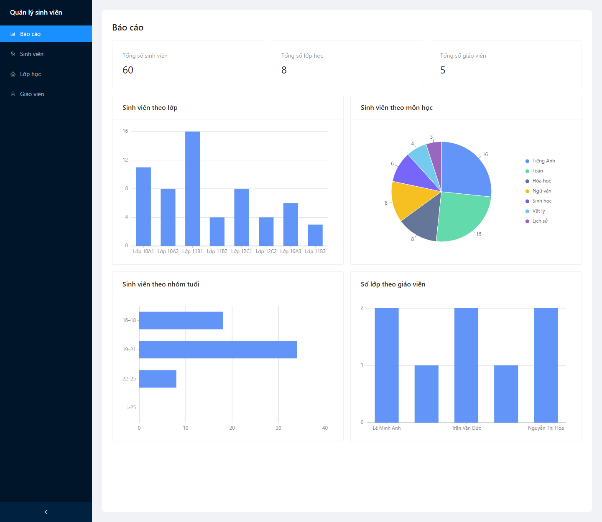
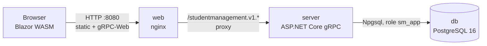
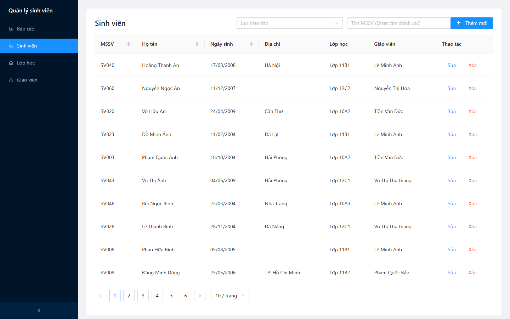
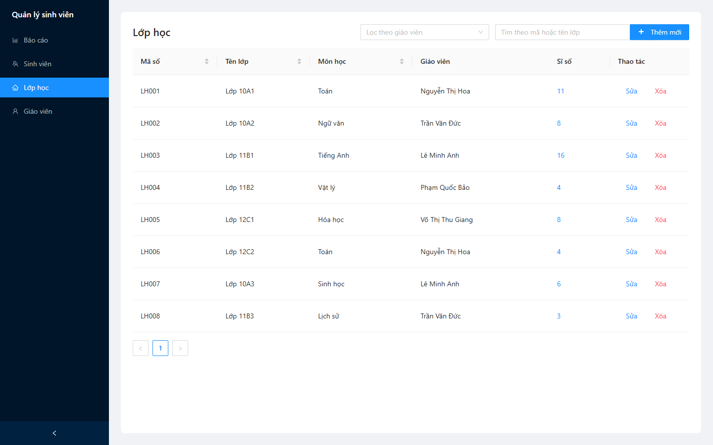
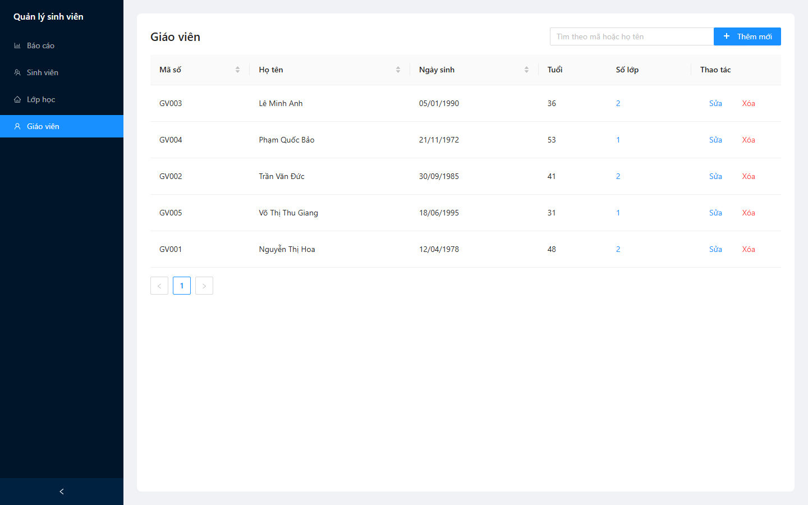

# Student Management System

Hệ thống quản lý sinh viên gộp 6 bài thực hành trong [Task.md](Task.md) thành một sản phẩm:

**Blazor WebAssembly + Ant Design** → gRPC-Web → **ASP.NET Core gRPC** → Application service → Repository / Unit of Work → **NHibernate** → **PostgreSQL 16**, chạy bằng **Docker Compose**.



| Tài liệu | Nội dung |
|----------|----------|
| [PROJECT_PLAN.md](PROJECT_PLAN.md) | Quyết định thiết kế, kiến trúc, gRPC contract, ánh xạ yêu cầu → file (mục 6), lộ trình |
| [docs/OOP_SOLID_MAP.md](docs/OOP_SOLID_MAP.md) | File/dòng thể hiện từng tính chất OOP, nguyên lý SOLID, design pattern |
| [db/erd.md](db/erd.md) | ERD và giải thích ràng buộc CSDL |
| [docs/DEMO.md](docs/DEMO.md) | Kịch bản demo 10 phút |

## Chạy nhanh (chỉ cần Docker)

```bash
git clone https://github.com/NguyenDag/TrainingSDS_StudentManagement.git
cd TrainingSDS_StudentManagement
cp .env.example .env          # đặt 2 mật khẩu trong .env
docker compose up --build
```

Mở <http://localhost:8080>. Lần đầu build mất vài phút. `docker compose ps` phải báo cả 3 service `healthy`.

CSDL được tạo và seed tự động (5 giáo viên, 8 lớp, 60 sinh viên) **chỉ khi volume còn rỗng**. Sau khi sửa script trong `db/init/`, chạy `docker compose down -v` để xóa volume rồi `up` lại.

## Kiến trúc



- **web**: nginx phục vụ file tĩnh của Blazor WASM và proxy các path gRPC-Web sang `server`. Trình duyệt chỉ thấy một origin nên không cần CORS.
- **server**: chạy trên image `aspnet:8.0-alpine` với user không phải root, health check tại `/healthz` (kiểm cả kết nối DB).
- **db**: PostgreSQL 16 (bản Debian, có ICU để sắp xếp tiếng Việt). App kết nối bằng role `sm_app` chỉ có quyền DML, không dùng superuser.

Thứ tự khởi động: `db` healthy → `server` healthy → `web`.

| Project | Vai trò | Tham chiếu |
|---------|---------|------------|
| `StudentManagement.Domain` | Entity, invariant nghiệp vụ (Bài 1) | — |
| `StudentManagement.Application` | Use case, DTO, validator, interface repository / UoW (Bài 3) | Domain |
| `StudentManagement.Infrastructure` | NHibernate mapping, repository, UoW, báo cáo (Bài 4) | Application, Domain |
| `StudentManagement.GrpcServer` | gRPC service, interceptor, composition root (Bài 5) | Application, Infrastructure |
| `StudentManagement.Web` | Blazor WASM + Ant Design + biểu đồ (Bài 6) | chỉ file `protos/*.proto` |

Client và server chỉ chia sẻ contract trong [protos/](protos/). [ArchitectureTests.cs](tests/StudentManagement.GrpcServer.Tests/ArchitectureTests.cs) kiểm tra các chiều tham chiếu trên.

## Cổng

| Cổng host | Service | Có ở | Dùng cho |
|-----------|---------|------|----------|
| `8080` | web (nginx) | mọi cấu hình | Giao diện + gRPC-Web |
| `5433` | db | `docker-compose.override.yml` (dev) | DBeaver / pgAdmin |
| `8081` | server (HTTP/2, native gRPC) | `docker-compose.override.yml` (dev) | `grpcurl`, Postman |

`docker compose up` tự gộp file override. Để chạy như production, chỉ mở cổng 8080:

```bash
docker compose -f docker-compose.yml up --build
```

Override cũng bật môi trường `Development` cho server (bật gRPC reflection, log Debug, log SQL), nên dùng được:

```bash
grpcurl -plaintext localhost:8081 list
grpcurl -plaintext -d '{"code":"SV001"}' localhost:8081 studentmanagement.v1.StudentService/GetStudentByCode
```

## Biến môi trường (`.env`)

| Biến | Dùng bởi | Ý nghĩa |
|------|----------|---------|
| `POSTGRES_PASSWORD` | `db` | Mật khẩu superuser `postgres`. App không dùng biến này. |
| `APP_DB_PASSWORD` | `db` (tạo role trong [00_app_role.sh](db/init/00_app_role.sh)), `server` (connection string) | Mật khẩu role `sm_app` |

`.env` nằm trong `.gitignore`. Compose sẽ dừng với thông báo lỗi nếu thiếu một trong hai biến.

## Chạy local để phát triển

Yêu cầu: .NET SDK 9.0.300 trở lên (xem [global.json](global.json); project target `net8.0` nên cần cả runtime 8.0), Docker.

```bash
docker compose up -d db       # PostgreSQL ở localhost:5433

# Connection string lưu trong user-secrets, không commit vào repo
dotnet user-secrets set "ConnectionStrings:Default" \
  "Host=localhost;Port=5433;Database=studentmanagement;Username=sm_app;Password=<APP_DB_PASSWORD>" \
  --project src/StudentManagement.GrpcServer

dotnet run --project src/StudentManagement.GrpcServer   # :8080 gRPC-Web, :8081 native gRPC
dotnet run --project src/StudentManagement.Web          # http://localhost:5062
```

Ở môi trường Development, Web gọi thẳng `http://localhost:8080`, và server cho phép CORS từ `http://localhost:5062`.

## Test

```bash
dotnet test
```

| Project | Phạm vi |
|---------|---------|
| `Domain.Tests` | Invariant, tuổi tối thiểu 16/18, giá trị biên |
| `Application.Tests` | Service, validator, DI; contract test chạy trên repository in-memory |
| `Infrastructure.Tests` | Mapping, query, sort tiếng Việt, ràng buộc, concurrency, số câu SQL; chạy trên PostgreSQL thật qua Testcontainers |
| `GrpcServer.Tests` | CRUD qua gRPC, mọi status code lỗi, báo cáo, kiến trúc |

`Infrastructure.Tests` và `GrpcServer.Tests` cần Docker đang chạy.

## CI

[.github/workflows/ci.yml](.github/workflows/ci.yml) chạy trên mỗi push vào `main` và mỗi PR: restore → build → test (Testcontainers trên runner `ubuntu-latest`) → `docker compose build`. Khi push tag `v*`, CI đẩy image `studentmanagement-server` và `studentmanagement-web` lên GHCR.

## Màn hình

| Sinh viên | Lớp học | Giáo viên |
|-----------|---------|-----------|
|  |  |  |

## Xử lý sự cố

| Triệu chứng | Cách xử lý |
|-------------|------------|
| Port 8080 hoặc 5433 đã bị chiếm | Đổi cổng bên trái trong `ports:` (vd. `"8088:80"`) |
| Sửa `db/init/*.sql` nhưng DB không đổi | Script chỉ chạy khi volume rỗng: `docker compose down -v` |
| `db` lỗi `bad interpreter` với `00_app_role.sh` | File bị chuyển sang CRLF; `.gitattributes` đã ép LF, hãy checkout lại file |
| `server` không healthy | `docker compose logs server`; thường do sai `APP_DB_PASSWORD` so với lúc volume được tạo (tạo lại bằng `down -v`) |
