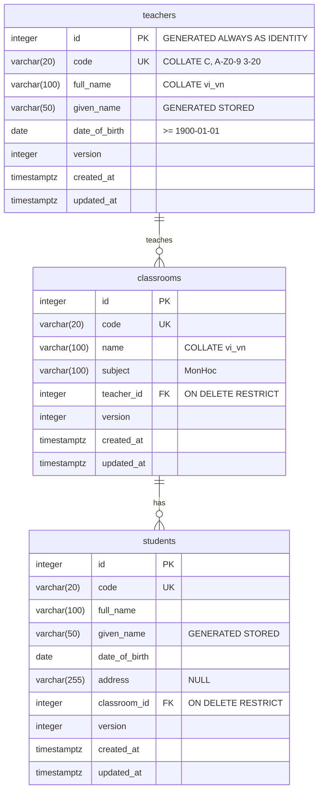

# Thiết kế CSDL (Bài 2)

Lưu toàn bộ dữ liệu của mô hình đối tượng Bài 1 (`Student`, `Classroom`, `Teacher`). Script: [init/01_schema.sql](init/01_schema.sql).



## Ánh xạ class → bảng

| Class (Bài 1) | Bảng | Ghi chú |
|---------------|------|---------|
| `Student.Classroom` (đối tượng) | `students.classroom_id` → `classrooms.id` | Quan hệ n–1 |
| `Classroom.Teacher` (đối tượng) | `classrooms.teacher_id` → `teachers.id` | Quan hệ n–1 |
| `Person` (abstract) | *(không có bảng)* | Mỗi lớp con một bảng (table per concrete class); cột chung lặp lại ở `teachers` và `students` |
| `Classroom.Subject` (`string`) | `classrooms.subject` | Kiểu nguyên thủy, không tách bảng |

Đạt 3NF: mọi cột không khóa phụ thuộc trực tiếp vào `id`. `given_name` suy ra từ `full_name` nhưng do DB tự tính (generated column), không thể lệch.

## Quyết định chính

| Quyết định | Lý do |
|------------|-------|
| Surrogate key `id` + `code` UNIQUE | Sửa mã không phải cascade khóa ngoại |
| `code COLLATE "C"` | B-tree index phục vụ được `LIKE 'SV00%'` |
| Collation ICU `vi_vn` cho tên | Sắp xếp đúng tiếng Việt: An < Ánh < Bình < Dũng < Đức < Giang |
| `given_name` generated `STORED` + index `(given_name, full_name, id)` | "Sắp theo tên" = theo tên riêng; `id` làm tie-breaker để phân trang ổn định |
| `ON DELETE RESTRICT` | Không xóa được lớp còn sinh viên, giáo viên còn lớp |
| Index trên mọi FK | PostgreSQL không tự tạo |
| Ngày sinh tương lai, tuổi tối thiểu kiểm ở domain | `CHECK` phải immutable, không dùng được `current_date`; tuổi tối thiểu khác nhau theo loại `Person` |
| `version` | Optimistic concurrency (NHibernate, M4) |
| Role `sm_app` chỉ có DML | Least privilege; app không chạy được DDL |

## Kiểm tra

```bash
docker compose down -v && docker compose up -d db                                   # tạo lại sạch
docker compose exec -T db psql -U postgres -d studentmanagement -v ON_ERROR_STOP=1 < db/verify.sql
docker compose exec -T db psql -U postgres -d studentmanagement < db/sample_queries.sql  # EXPLAIN ANALYZE
```

`verify.sql` kiểm: trùng mã, mã chữ thường, họ tên rỗng, ngày sinh < 1900, FK không tồn tại, xóa lớp còn SV, xóa GV còn lớp, thứ tự sắp xếp tiếng Việt, `sm_app` không `CREATE`/`DROP`/`ALTER` được. Chạy trong transaction rồi `ROLLBACK`, không để lại dữ liệu.

> Script trong `init/` chỉ chạy khi volume rỗng. Sửa schema thì `docker compose down -v` rồi `up` lại.
